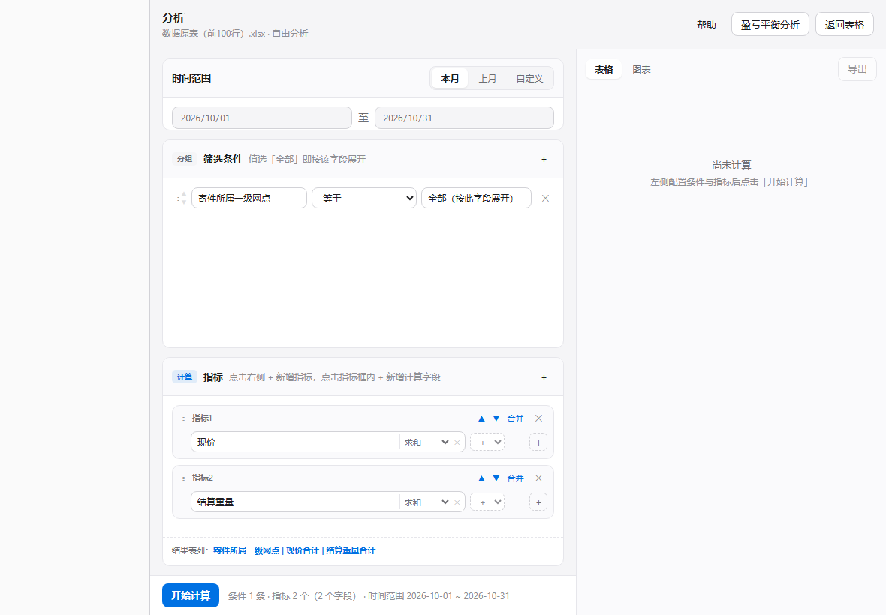
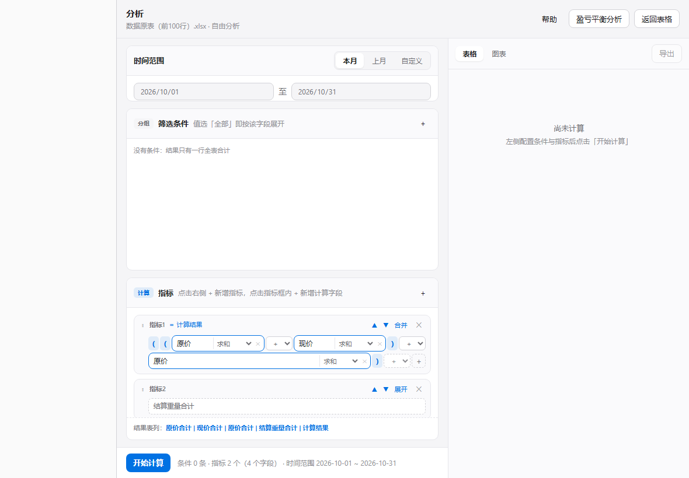
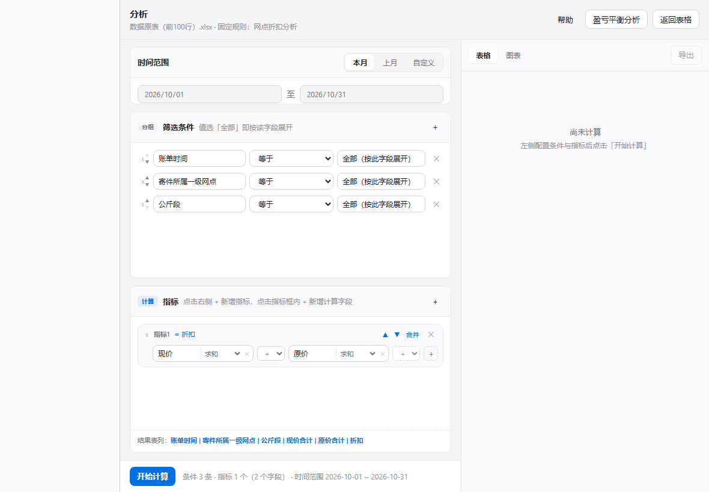

# 算账工作台 · Accounting Workbench

> 面向快递 / 物流加盟网点结算场景的**单机桌面分析工具**：导入系统导出的账单明细，一键算出货量、单价、折扣与盈亏平衡，并导出可直接交付的看板与报表。

Windows 10 / 11 · 单机运行 · 断网可用 · 数据不出本机

---

## 为什么做这个

网点算账长期依赖少数 Excel 熟手：口径散落在各人的表格里，换个人就换一套算法，同一个数字两次算出来可能不一样。

本项目把口径**固化进程序**：明细导入后由固定的指标体系计算，业务人员只需填少量政策参数（包仓单价、折扣目标等），就能得到可复现的结果，并导出给上级或网点。

## 功能

| 模块 | 说明 |
|---|---|
| 导入 | 支持系统导出的 xlsx 账单明细，自动识别表头、跳过公式列 |
| 一键算（看板） | 按网点 / 省份分组，输出 6 个公斤段的货量、单价与折扣，含加权平均与简单平均 |
| 分析 | 自由组合筛选条件与指标表达式（支持嵌套括号与四则运算），出表 + 折线 / 柱状 / 饼图 |
| 盈亏平衡 | 两种模式：手动测算（L = mZ + B、保本折扣、1% 折扣）与表格取数（组合拆组、逐组政策、判定与合计） |
| 导出 | 表格导出 xlsx / xls / csv；图表导出 PDF / JPEG；盈亏平衡一次导出四类文件 |
| 项目库 | 本地 SQLite 保存项目与输入快照，打开即回填上次的配置 |

## 截图

| 分析页 | 派生指标（括号表达式） |
|---|---|
|  |  |



## 技术架构

```
Tauri 2 (Rust shell)
  └─ React 18 + TypeScript (Vite)    ← 前端：ag-grid 表格、ECharts 图表、Zustand 状态
       └─ Python FastAPI sidecar     ← 计算：pandas / numpy / openpyxl / matplotlib
            └─ SQLite (projects.db)  ← 项目与输入快照
```

- **单文件安装**：PyInstaller 打包 sidecar，NSIS 生成 Windows 安装包，内嵌中文字体（Noto Sans CJK），装机即用
- **断网可用**：全部计算在本地完成，不依赖任何外部服务
- **派生指标表达式**：支持嵌套括号与四则优先级，分母为 0 时留空而不是报错

## 工程质量

- 后端 **pytest 163 例**、前端 **vitest 97 例**，全部通过
- `backend/scripts/check_caliber.py`：口径守门脚本，改动计算逻辑后先跑它
- `backend/scripts/e2e_real_data.py`：真实数据全链路冒烟
- TypeScript 严格模式（`tsc --noEmit` 通过）

## 快速开始

```bash
# 前端
npm install
npm run dev            # Vite 开发服务器
npm run typecheck      # 类型检查
npm test               # 前端测试（vitest）

# 后端
cd backend
pip install -r requirements.txt
python -m accounting_backend.main     # FastAPI sidecar

# 桌面壳
npm run tauri dev

# 打包（Windows）
powershell -File scripts/build-windows.ps1
```

更细的安装与目录说明见 [INSTALL.md](INSTALL.md)，面向业务同事的操作步骤见 [USER_GUIDE.md](USER_GUIDE.md)，交付状态见 [DELIVERY.md](DELIVERY.md)。

## 目录结构

```
src/          React 前端（页面、组件、状态、图表）
src-tauri/    Tauri 外壳（Rust 命令、打包配置、图标）
backend/      FastAPI sidecar（api / compute / chart / io / data）
assets/       图标、字体、界面截图
scripts/      开发与打包脚本
installer/    NSIS 安装脚本
```

## 说明

- 仓库**不含任何企业业务数据**；截图中的数字为演示数据。
- 代码用于个人作品展示与学习交流。
