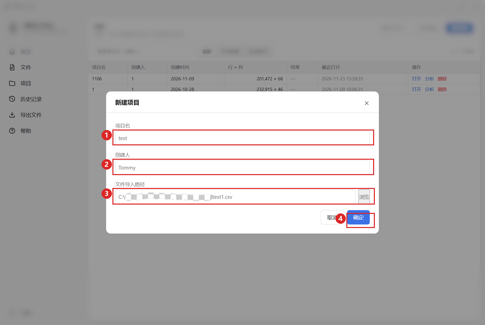
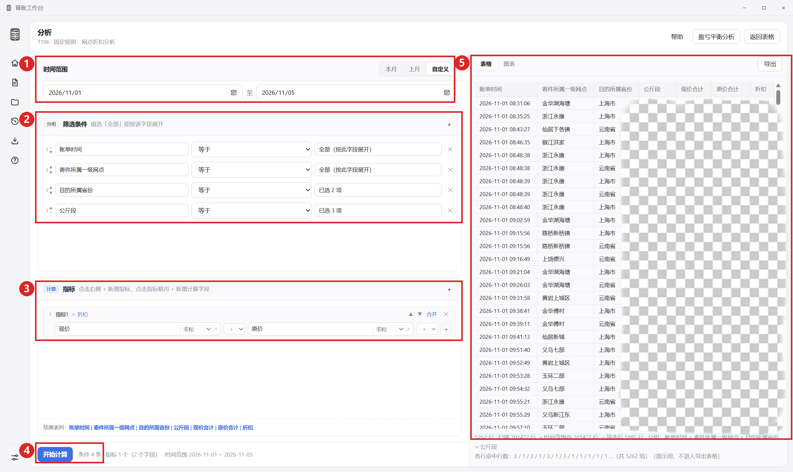
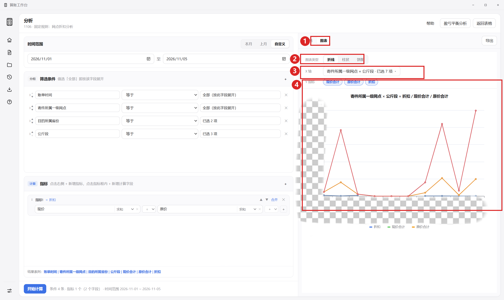
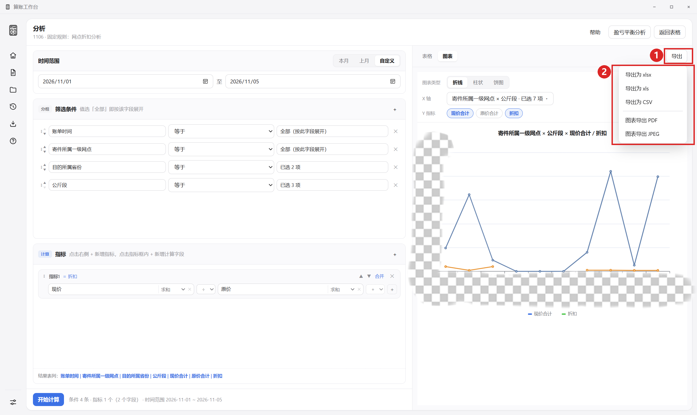
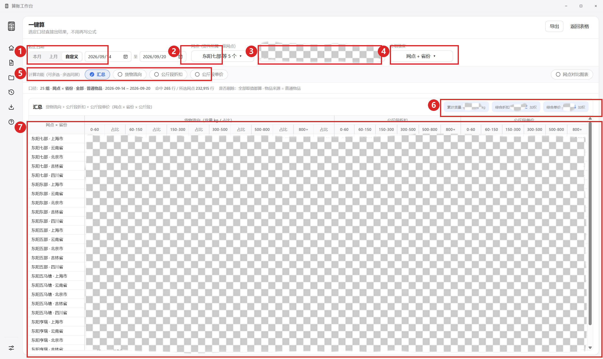
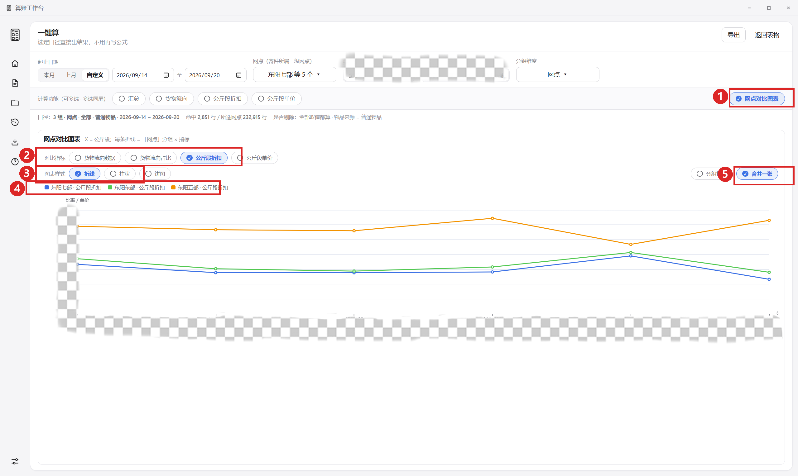
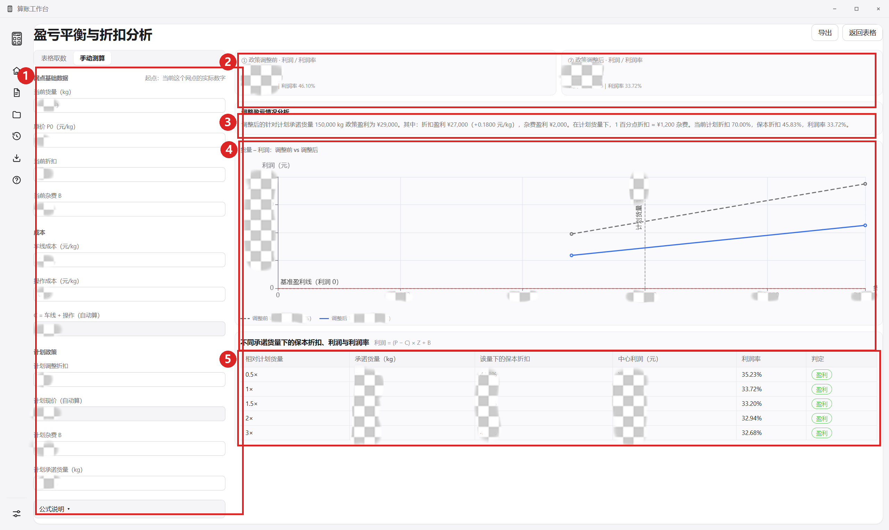
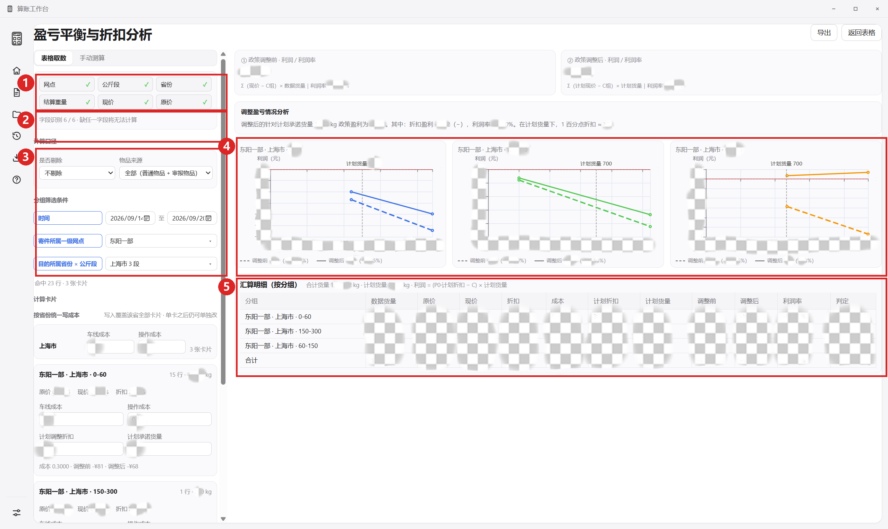
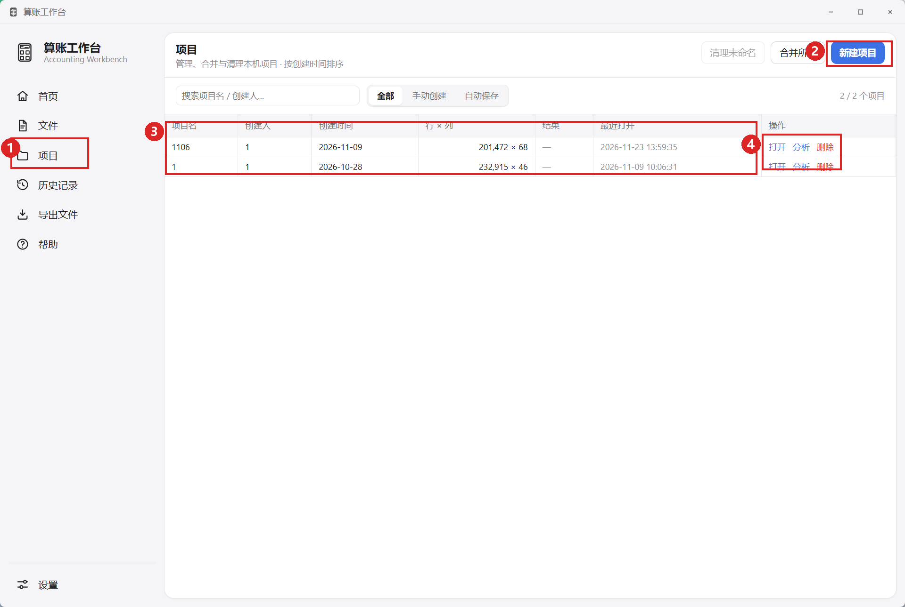

# 算账工作台 · Accounting Workbench

> 面向快递 / 物流加盟网点结算场景的**单机桌面分析工具**：导入系统导出的账单明细，一键算出货量、单价、折扣与盈亏平衡，并导出可直接交付的看板与报表。

Windows 10 / 11 · 单机运行 · 断网可用 · 数据不出本机

> 下文截图中的数值区域已做脱敏处理，仅用于说明操作位置。

---

## 快速上手（5 个板块）

- [一、导入文件与新建项目](#一导入文件与新建项目)
- [二、分析板块：自由组合条件与指标](#二分析板块自由组合条件与指标)
- [三、一键算板块：按口径直接出看板](#三一键算板块按口径直接出看板)
- [四、盈亏平衡分析板块](#四盈亏平衡分析板块)
- [五、项目管理界面](#五项目管理界面)

---

## 一、导入文件与新建项目

从系统导出的 xlsx / csv 明细开始：新建项目 → 选文件 → 导入完成即可分析。



1. **项目名** —— 起个能认出期间的名字，例如「1106」表示 11 月 6 日那批。
2. **创建人** —— 填自己的名字，便于多人共用一台机器时区分。
3. **文件导入路径** —— 点「浏览」选系统导出的明细文件。**只读第一个工作表**，表格里的公式和颜色建议先在 Excel 里清掉。
4. **确定** —— 导入期间会提示「因导入表格需要一定时间，请耐心等待…」，提示消失即完成，表格出现在页面上。

> 入口在「项目」页的右上角，见[第五节](#五项目管理界面)的 ②。

## 二、分析板块：自由组合条件与指标

按任意维度分组、用表达式算指标，右侧直接出表或出图，并可一键导出。

### 表格视图



1. **时间范围** —— 本月 / 上月 / 自定义。自定义可精确到日。
2. **筛选条件** —— 「分组」即维度（账单时间、寄件所属一级网点、目的所属省份、公斤段…），值可以是「全部（按此字段展开）」或勾选若干项。
3. **指标** —— 点「+」新增指标，在指标框内选字段 + 计算方式（求和/平均/计数…），多个字段可用 `+ − × ÷` 与括号组合成表达式，例如 `现价(求和) ÷ 原价(求和)` 就是折扣。
4. **开始计算** —— 左下角。填好条件后点它出结果。
5. **结果表** —— 每行是一个分组组合，列是指标；底部会显示「扫描 N 行 → 筛至 N 行 → 分组 N 组」的口径说明。

### 图表视图



1. **图表** —— 右上角页签，与「表格」互斥切换。
2. **图表类型** —— 折线 / 柱状 / 饼图。
3. **X 轴 / Y 指标** —— X 轴可选单个维度或「维度 × 维度」组合；Y 指标可同时选多个，图上会画多条线。
4. **图表区** —— 双击任意图表可放大查看。

### 导出



1. **导出** —— 结果区右上角。
2. **导出格式** ——
   - 表格：`xlsx` / `xls` / `CSV`
   - 图表：`PDF` / `JPEG`

导出的文件走系统「另存为」，也可在左侧「导出文件」里找回历史导出并打开所在路径。

## 三、一键算板块：按口径直接出看板

选口径 → 直接出结果，不用写公式。适合每天固定口径的例行算账。

### 汇总表



1. **起止日期** —— 本月 / 上月 / 自定义。
2. **网点** —— 可多选，默认全部；多选时折叠显示为「等 N 个」。
3. **是否剔除 / 物品来源** —— 剔除规则与物品来源（全部 / 审报物品 / 普通物品），这是口径的核心开关。
4. **分组维度** —— 网点 / 省份 / 网点 × 省份 等。
5. **计算功能** —— 可多选、多选同屏：汇总 / 货物流向 / 公斤段折扣 / 公斤段单价。
6. **汇总卡** —— 当前口径下的累计货量、综合折扣、综合单价（带「加权」标记的为加权口径）。
7. **结果表** —— 左侧固定「网点 × 省份」，右侧按公斤段展开货量、占比、折扣与单价。

> 页面顶部的「口径」一行会实时显示当前条件命中了多少行、所选网点共有多少行，方便核对是否选错。

### 网点对比图表



1. **网点对比图表** —— 右上角，与「汇总」同属「计算功能」的二选一。
2. **对比指标** —— 货物流向数据 / 货物流向占比 / 公斤段折扣 / 公斤段单价。
3. **图表样式** —— 折线 / 柱状 / 饼图。
4. **图例** —— 每个网点一条线，X 轴为公斤段。
5. **合并一张 / 分组拆分** —— 一张大图，或每个网点单独一张小图。

导出：右上角「导出」与[第二节](#二分析板块自由组合条件与指标)一致；图表可导出 PDF / JPEG，也可存成「一个文件夹四类文件」的形式。

## 四、盈亏平衡分析板块

围绕「利润 = (P − C) × Z + B」做政策试算，两种模式：**手动测算**（单个口径自己填）与**表格取数**（从明细聚合成多张卡片）。

### 手动测算



1. **输入区** —— 网点基础数据（当前货量、原价 P0、当前折扣、当前杂费 B）+ 成本（车线成本、操作成本，C 自动算）+ 计划政策（计划调整折扣、计划现价、计划杂费、计划承诺货量）。填一个值，右侧立刻重算。
2. **结论卡** —— ① 政策调整前、② 政策调整后的利润与利润率对照。
3. **调整盈亏情况分析** —— 一段话结论：折扣盈利 / 杂费盈利、1 百分点折扣值多少钱、当前折扣与保本折扣。
4. **利润–货量图** —— 调整前（虚线）与调整后（实线）两条利润线，交叉点即保本点；竖虚线标出计划货量。
5. **不同承诺货量下的保本折扣、利润与利润率** —— 0.5× / 1× / 1.5× / 2× / 3× 五档扫描，最后一列给出「盈利 / 亏损」判定。

### 表格取数



1. **字段识别** —— 6 个必需字段（网点、公斤段、省份、结算重量、现价、原价）的勾选状态，缺任一字段无法计算。
2. **计算口径** —— 是否剔除 + 物品来源。
3. **分组筛选条件** —— 时间、网点、目的省份 × 公斤段；下方显示「命中 N 行 · N 张卡片」。
4. **计算卡片** —— 每个分组一张卡：原价 / 现价 / 折扣、车线成本、操作成本、计划折扣、计划承诺货量；卡片可单独改，也可「按省份统一写成本」批量覆盖。
5. **汇算明细（按分组）** —— 每个分组的货量、原价、现价、折扣、成本、计划折扣、计划货量，以及调整前后的利润、利润率与判定；末行是合计。

导出：右上角「导出」可一次导出四类文件 —— 整页 PDF、网格 JPEG、单图 JPEG、汇算明细 XLSX。

## 五、项目管理界面



1. **左侧导航** —— 首页 / 文件 / 项目 / 历史记录 / 导出文件 / 帮助 / 设置。
2. **新建项目** —— 右上角，打开第一节的导入对话框。
3. **项目列表** —— 项目名、创建人、创建时间、行 × 列（多少行多少字段）、结果、最近打开时间；支持搜索与「全部 / 手动创建 / 自动保存」筛选。
4. **操作列** —— **打开**（回到表格页）、**分析**（直接进分析板块）、**删除**。
5. **清理未命名 / 合并所选** —— 批量整理自动保存的临时项目。

---

## 技术架构

```
Tauri 2 (Rust shell)
  └─ React 18 + TypeScript (Vite)    ← 前端：ag-grid 表格、ECharts 图表、Zustand 状态
       └─ Python FastAPI sidecar     ← 计算：pandas / numpy / openpyxl / matplotlib
            └─ SQLite (projects.db)  ← 项目与输入快照
```

- **单文件安装**：PyInstaller 打包 sidecar，NSIS 生成 Windows 安装包，内嵌中文字体（Noto Sans CJK），装机即用
- **断网可用**：全部计算在本地完成，不依赖任何外部服务

## 更详细的安装与目录说明见 [INSTALL.md](INSTALL.md)，面向业务同事的操作步骤见 [USER_GUIDE.md](USER_GUIDE.md)。

## 目录结构

```
src/          React 前端（页面、组件、状态、图表）
src-tauri/    Tauri 外壳（Rust 命令、打包配置、图标）
backend/      FastAPI sidecar（api / compute / chart / io / data）
assets/       图标、字体等
scripts/      开发与打包脚本
installer/    NSIS 安装脚本
```

## 说明

- 代码用于个人作品展示与学习交流。
- 未经软件版权所有人同意，自行修改代码或改变用途等行为造成的后果由其本人承担。
